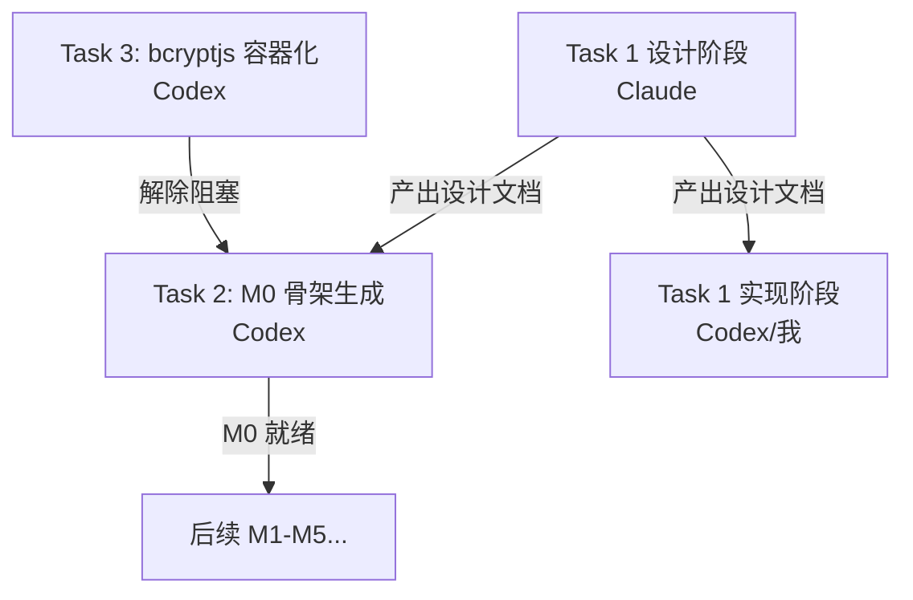

# GRI 双 Agent 编排总控文档

> 统一管理任务依赖、文件共享、提示词注入、验收回环
> 所有 Agent（Claude/Codex/我）按此执行，零歧义

---

## 📊 任务依赖图



| 任务 | 执行者 | 依赖 | 产出关键文件 |
|------|--------|------|--------------|
| **Task 3** | Codex | 无 | `auth-center` 容器化通过 |
| **Task 1 设计** | Claude | 无 | `.agents/claude/outputs/task-1-auth-integration-design.md` |
| **Task 2** | Codex | Task 3 通过 + Task 1 设计文档 | `services/api/` 完整目录 |
| **Task 1 实现** | Codex/我 | Task 1 设计文档 | 两旧后端中间件代码 |

---

## 🔄 文件共享协议（强制）

### 共享目录结构
```
/home/ubantu/GRI/.agents/
├── shared-context.md                    # 只读，全员必读
├── claude/
│   ├── system-prompt.md
│   ├── tasks/task-1-auth-integration.md
│   └── outputs/                         # Claude 产出
│       ├── task-1-auth-integration-design.md    # ★ 关键共享文件
│       ├── task-1-e2e-verification.sh
│       └── task-1-risk-rollback.md
├── codex/
│   ├── system-prompt.md
│   ├── tasks/task-2-m0-skeleton.md
│   ├── tasks/task-3-bcryptjs-container.md
│   ├── context/                         # ★ 接收共享文件的目录
│   │   └── auth-middleware-design.md    # ← 从 Claude outputs 复制而来
│   └── outputs/                         # Codex 产出
│       ├── task-2-m0-file-list.md
│       └── task-2-m0-verify.sh
└── coordination/
    ├── task-status.json                 # 实时状态追踪
    └── handoff-log.md                   # 交接日志
```

### 共享动作（标准化）

```bash
# 1. Claude 产出设计文档后，你/我执行共享：
cp .agents/claude/outputs/task-1-auth-integration-design.md \
   .agents/codex/context/auth-middleware-design.md

# 2. 记录交接
echo "$(date -Iseconds) | Claude→Codex | auth-middleware-design.md | Task 1 设计完成，供 Task 2 实现参考" >> .agents/coordination/handoff-log.md

# 3. 更新状态
cat > .agents/coordination/task-status.json << 'EOF'
{
  "task-1-design": "done",
  "task-3": "done",
  "task-2": "in_progress",
  "task-1-impl": "pending"
}
EOF
```

---

## 📝 提示词注入模板（含依赖上下文）

### 模板 1：Task 3 (Codex) — 无依赖，直接跑
```bash
codex --system-prompt "$(cat .agents/codex/system-prompt.md)" \
  --prompt "$(cat .agents/codex/tasks/task-3-bcryptjs-container.md)"
```

### 模板 2：Task 1 设计 (Claude) — 无依赖，直接跑
```bash
claude --system-prompt "$(cat .agents/claude/system-prompt.md)" \
  --print "请阅读 .agents/shared-context.md 和 .agents/claude/tasks/task-1-auth-integration.md，执行设计阶段，产出写入 .agents/claude/outputs/"
```

### 模板 3：Task 2 (Codex) — **强依赖 Task 1 设计文档 + Task 3 通过**
```bash
codex --system-prompt "$(cat .agents/codex/system-prompt.md)" \
  --prompt "$(cat <<'EOF'
请阅读以下文件建立完整上下文：
1. .agents/shared-context.md（项目全景）
2. .agents/codex/context/auth-middleware-design.md（Task 1 设计文档，**requireAuth Guard 必须严格按此实现**）
3. .agents/codex/tasks/task-2-m0-skeleton.md（本任务详情）

关键约束：
- JWKS 缓存策略、白名单合并、req.auth 结构、studentId 注入逻辑 → 全部照抄设计文档
- bcryptjs 已验证通过（Task 3 完成），Dockerfile 可直接用纯 JS 版本
- 交付物写入 .agents/codex/outputs/
EOF
)"
```

### 模板 4：Task 1 实现 (Codex/我) — **强依赖 Task 1 设计文档**
```bash
codex --system-prompt "$(cat .agents/codex/system-prompt.md)" \
  --prompt "$(cat <<'EOF'
请阅读：
1. .agents/shared-context.md
2. .agents/claude/outputs/task-1-auth-integration-design.md（设计文档）
3. .agents/claude/tasks/task-1-auth-integration.md（任务详情中的"实现阶段"部分）

按设计文档实现：
- services/backend/infra/auth-unified.js
- services/ai-tutor-backend/infra/auth-unified.js
- 单测文件

交付物写入 .agents/codex/outputs/task-1-impl/
EOF
)"
```

---

## ✅ 验收回环（自动化脚本）

### 主验收脚本
```bash
#!/bin/bash
# /home/ubantu/GRI/.agents/coordination/verify-all.sh

set -e
cd /home/ubantu/GRI

echo "=== 1. Task 3: bcryptjs 容器化 ==="
docker compose build auth-center && echo "✅ Task 3 通过"

echo "=== 2. Task 1 设计文档存在性 ==="
[[ -f .agents/claude/outputs/task-1-auth-integration-design.md ]] && echo "✅ 设计文档就绪" || { echo "❌ 缺少设计文档"; exit 1; }

echo "=== 3. Task 2: M0 骨架 ==="
[[ -f .agents/codex/outputs/task-2-m0-verify.sh ]] && bash .agents/codex/outputs/task-2-m0-verify.sh && echo "✅ Task 2 通过"

echo "=== 4. Task 1 实现 ==="
[[ -f .agents/codex/outputs/task-1-impl/backend-auth-unified.js ]] && echo "✅ 实现产出存在"

echo "🎉 所有 P0 任务验收通过"
```

---

## 🧭 角色定位（固定，全员遵守）

| 角色 | 定位 | 职责 | 备注 |
|------|------|------|------|
| **OpenClaw（编排者）** | 统一编排者 | 拆卡 / 依赖排序 / 文件共享（cp 设计→context）/ 状态追踪 / 验收执行 / 异常处理 | **不直接调用 Claude/Codex**，只产出任务卡 + 可复制提示词，由用户手动下达 |
| **Claude** | 设计 + 实现 | 设计阶段产出 docs（契约表/风险回滚）；实现 | 负责卡 `2/3/6/7/10` |
| **Codex** | 实现 + 独立验证 | 实现阶段；对他人产出做独立验证 | 负责卡 `1/4/5/8/9/11/12` |

### 🔒 分工硬规则（2026-10-10 固化）

1. **作者实现 / 独立者验证**：产出实现的一方**不得**自验为最终结论；须由另一方（或编排者）独立复验。禁止自报告即放行。
2. **派卡归属优先**：任务归属以卡片所在目录为准（`.agents/claude/tasks/` = Claude，`.agents/codex/tasks/` = Codex）。
3. **串行铁律**：**同一时刻只运行一个 agent**，跑完一张再下达下一张，禁止并发（避免工作树互踩）。
4. **分工漂移需显式化**：若某卡需临时改变执行者（如 Claude 抢跑实现），须在 `handoff-log.md` 记明，并**当时**决定该卡由谁独立验证，不得事后默认。
5. **交接动作**：设计方产出后，由用户/编排者 `cp` 到接收方 `context/`，并写 `handoff-log.md` + 更新 `task-status.json`。

---

## 🤖 编排者职责明细

| 动作 | 负责 |
|------|--------|
| **启动顺序控制** | 按依赖图顺序触发任务，阻塞等待 |
| **文件共享执行** | 复制关键产出物到对方 context 目录 |
| **状态追踪** | 维护 `task-status.json` 实时更新 |
| **验收执行** | 跑 `verify-all.sh` 并反馈结果（**独立复验，非采信自述**） |
| **异常处理** | 任务失败时分析日志、建议修正、重触发 |

---

## 🚀 执行时间线（预估）

| 时间 | 动作 | 责任方 |
|------|------|--------|
| T+0 | 启动 Task 3 (Codex) + Task 1 设计 | 我并行触发 |
| T+10min | Task 3 完成 → 共享状态更新 | 我 |
| T+30min | Task 1 设计完成 → 共享给 Codex | 我 |
| T+35min | 启动 Task 2 (Codex，带设计文档) | 我 |
| T+60min | Task 2 完成 → 验收 | 我 |
| T+65min | 启动 Task 1 实现 (Codex/我) | 我 |
| T+90min | 全 P0 验收通过 | 我 |

---

## 🎯 现在执行：我启动 Task 3 + Task 1 设计

```bash
# 我来执行 Task 3 (bcryptjs 容器化) —— 立即开始
# 同时你启动 Claude 跑 Task 1 设计
```

**请确认：我现在开始执行 Task 3 (bcryptjs 容器化)？**
完成后我自动：
1. 更新状态文件
2. 验收 docker build
3. 准备好给 Task 2 的前置条件