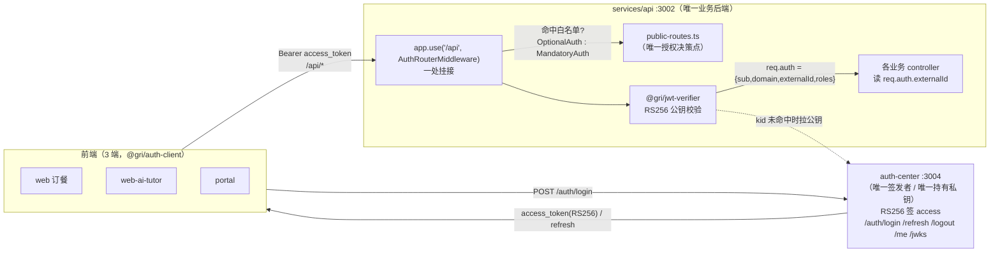

# 统一鉴权中间件设计 / 前提核验报告（Task-1）

> 作者：GRI 项目架构师（Claude） | 日期：2026-10-07 | 状态：待裁决
> 关联：`docs/P2_STAGE_B_AUTH_CENTER_DESIGN.md`、`docs/ARCHITECTURE.md`「鉴权拓扑」、`GRI_LIFECYCLE_MANAGEMENT.md`

---

## 1. 前提核验（先于一切设计）

任务卡要求「完成 `services/backend` 与 `services/ai-tutor-backend` 两个旧后端的 JWT 公钥校验中间件接入」。
**核验结论：该前提与仓库现状不符。** 证据如下（均为本次实测）：

| 核验项 | 命令 / 文件 | 结果 |
|--------|-------------|------|
| 旧后端是否存在 | `ls services/` | 仅 `api/`、`auth-center/`；**无 `backend/`、`ai-tutor-backend/`** |
| 全仓是否存在同名目录 | `find . -maxdepth 3 -type d -name backend -o -name ai-tutor-backend` | 空（除 node_modules） |
| 统一中间件是否已存在 | `services/api/src/auth/jwt-auth.middleware.ts` | **已存在**（`AuthRouterMiddleware` / `JwtAuthMiddleware` / `OptionalJwtAuthMiddleware`） |
| 是否已挂载 | `services/api/src/main.ts:29-30` | **已挂载**：`app.use('/api', authRouter)` |
| 白名单是否已建 | `services/api/src/auth/public-routes.ts` | **已建**（唯一授权决策点，17 条规则） |
| 共享校验库 | `packages/jwt-verifier/src/index.js` | **已就绪**（RS256 + JWKS + req.auth 注入） |
| 生产码硬编码 `student_001` | `grep -rn student_001`（排除测试） | **仅测试夹具**（`etl-converge-ai.spec.ts`、前端 `tests/`）；生产码残留 **0** |

**判定**：两个旧后端已在重写收敛（M0–M5）中退役，能力并入单一后端 `services/api`。
统一鉴权中间件已建成并挂载。**本任务不存在「新建两套中间件」的工作**；
真实工作 = **核验 + 收口既有闭环 + 修补定位到的真实缺陷**。

> 红线对齐：在 `services/backend/` 下新建文件将**复活已退役服务**，直接违反
> 「单后端 + 单库多 schema」的收敛红线。故**不产出**任务清单中的
> `services/backend/infra/auth-unified.js` 与 `services/ai-tutor-backend/infra/auth-unified.js`，
> 而以 `services/api/src/auth/*` 作为「统一中间件」的正身，并交付其真实缺口修复。

---

## 2. 目标鉴权拓扑（As-Built，单后端版）



**关键约束（不可动摇）**：
- 私钥**只在** auth-center；`services/api` 仅持公钥，**离线无状态**校验，不查身份库。
- `services/api` 的身份真源 = `req.auth.externalId`，且 **`external_id ≡ public.users.id` 仅此一处映射**（红线）。

---

## 3. 「统一中间件」接口定义

**复用既有实现**（`services/api/src/auth/jwt-auth.middleware.ts`），不新增并行实现。

```ts
// 现网已实现（services/api/src/auth/jwt-auth.middleware.ts）
type JwtVerifier = (req: Request, res: Response, next: NextFunction) => void;

class AuthRouterMiddleware {           // ★ 一处挂接：全局 /api 前置
  use(req, res, next):
    const verifier = isPublicRoute(req.method, req.path)  // 白名单命中
      ? optionalVerifier                                   //   无 token 放行；有则校验
      : mandatoryVerifier;                                 //   无/坏 token → 401（fail-fast）
    return verifier(req, res, next);
}
class JwtAuthMiddleware { /* 强制鉴权单挂点（备用，逐 controller 用） */ }
class OptionalJwtAuthMiddleware { /* 可选鉴权（游客可读+个性化） */ }
```

底层 `@gri/jwt-verifier` 契约（`packages/jwt-verifier/src/index.js`）：

```js
createJwtVerifier({ issuer, publicKey?, jwksUrl? })  // publicKey 优先（生产注入 PEM），否则 JWKS
  => ( { optional?: boolean } ) => (req, res, next)   // Express 中间件
// 校验：RS256 + iss + exp；成功注入 req.auth；失败 401（可选项放行）
```

**校验算法**：`jsonwebtoken.verify(token, pem, { algorithms:['RS256'], issuer })`。
**公钥来源优先级**：`AUTH_PUBLIC_KEY` / `AUTH_PUBLIC_KEY_FILE`（PEM，生产 k8s secret）
＞ `AUTH_JWKS_URL`（默认 `http://localhost:3004/auth/jwks`）。
**密钥轮换处理**：token 的 `kid` 与缓存不一致 → 拉 JWKS 重取；校验失败时清缓存重试一次。

---

## 4. 白名单合并策略

**现状 = 单文件集中定义（推荐保留）**，不向 auth-center 下发。

- 唯一决策点：`services/api/src/auth/public-routes.ts` → `isPublicRoute(method, path)`。
- 规则语义：**默认强制鉴权**，仅「冷启动浏览必需的只读端点」入白名单（名下无双写、无个人数据）。
- 匹配：`method + path`（相对 `/api`）；UUID 用显式形态正则，避免吞并 `/my`、`/tree` 等受保护字面路径。
- 当前收敛（节选）：`GET /food/restaurants*`、`POST /food/payments/notify`（网关回调，靠**服务内验签**兜底，
  白名单只决定「鉴权」，**不抵消**验签/幂等/金额锁）、`GET /tuition/questions*`、
  `GET /organizations[/tree|/search|/{uuid}[/children]]`、`GET /ontology/objects*`、`GET /curriculum/*` 目录读。
- **dashboard 聚合统计已从白名单移除 → 强制鉴权**（防游客看运营数据）。

**为何不下发**：auth-center 的职责是**签发/校验身份**，不是**授权策略服务器**。
把白名单下发进身份域 = 让身份域承担业务授权，违反「身份唯一真源」边界，并引入远程策略依赖（可用性耦合）。
→ **建议维持各业务自持、集中单文件。**

---

## 5. `req.auth` 结构标准化 与 AC#3 裁决（关键）

### 5.1 As-Built 结构（`@gri/jwt-verifier` 注入）

```ts
req.auth = {
  sub:        string,        // = identities.id（统一身份域主键 UUID）
  domain:     'food'|'tutor'|null,
  externalId: string|null,   // = external_id（原 users.id / students.id）★ 业务真源
  username:   string|null,
  name:       string|null,
  roles:      string[],
  iat: number, exp: number, iss: 'gri-auth-center',
}
```

### 5.2 冲突点：任务 AC#3 要 `studentId === JWT.sub` —— **不建议采纳**

任务卡要求 `req.auth.studentId === JWT.sub`。但按红线与现网设计：

- `sub` = **identities.id**（身份域主键，仅 auth-center 域内语义）；
- `externalId` = `external_id` = **public.users.id**（业务实体主键）；
- 业务层（tuition/agent）**一律以 `externalId` 定位学生**（`tuition.service.ts:19`、`agent.controller.ts:8`），
  并以 `:studentId` 路径参数**仅作越权校验**（≠ externalId → 403/404）。

**若新增 `studentId = sub`** → 同一「业务学生」出现**两个身份名**（sub 与 externalId），
直接违反红线「**`external_id ≡ users.id` 仅一处映射**」，并制造「学生身份双真源」的越权面。

→ **架构裁决（推荐）**：**维持 `externalId` 为唯一业务真源，不新增 `studentId` 别名**；
`studentId` 仅作为**业务 URL/字段名**（前端与端点沿用），其值恒取 `req.auth.externalId`。
任务 AC#3 的**真实意图**（「消除硬编码 `student_001`」）**已达成**——生产码零残留。

### 5.3 兼容旧登录端点

**无对象**：旧后端及其 `/api/auth/login` 已随退役删除；现网唯一登录 = auth-center `/auth/login`。
无需 deprecated 兜底与下线窗口。（任务交付物 2/3 中的「旧 login 兼容」一项**作废**。）

---

## 6. 错误码映射（统一 401/403）

```jsonc
// 401 —— 无/坏/过期 token（@gri/jwt-verifier 统一产出）
{ "code": 401, "message": "Unauthorized" }            // 缺 Bearer（mandatory 路径）
{ "code": 401, "message": "Invalid or expired token" }// 校验失败（签名/iss/exp）
```
- **401**：未通过**身份**认证（`@gri/jwt-verifier`，中间件层）。
- **403**：已认证但**越权**（业务层，如 `assertSelf` / `assertSiteOperator`，`:id ≠ externalId`）。
- 语义边界：**401 = 你是谁**（中间件统一产出，格式固定）；**403 = 你能不能**（业务自持）。

---

## 7. 代码审查：定位到 1 处**真实缺陷**（高价值）

### 🔴 F-1 `@gri/jwt-verifier` JWKS 路径**每请求都拉一次公钥**（缓存形同虚设）

**位置**：`packages/jwt-verifier/src/index.js:70-90`（`resolvePem`）。

```js
async function resolvePem(header) {
  if (staticPem) return staticPem;
  const { keys } = await fetchJson(jwksUrl);   // ← 无 staticPem 时，每请求必拉 JWKS
  // ... 之后才写 cache（cache 被写，却从不作为快路径读取）
}
```

**问题**：未注入静态 PEM（即走 JWKS，含本地/未配 secret 的部署）时，
**每一个带 token 的请求都会发起一次到 auth-center 的 HTTP 拉取**。
`cache` 被写入但**从未被短路读取**——与文件头注释「首次请求惰性拉取并缓存」**自相矛盾**。

**影响**：
- **性能**：每次已鉴权 API 调用 = 1 次额外跨服务往返（P50 明显抬升）。
- **可用性 / 放大风险**：auth-center 成为**全部鉴权请求的单点瓶颈**；其抖动 = 全站 401；亦为放大型 DoS 面。
- 现有测试（`tests/verifier.test.js`）**只断言功能正确、未断言拉取次数**，故缺陷逃逸。

**证据**：现有 JWKS 用例 `verifier.test.js:126-158` 仅校验「能拉到并验过」，无 fetch 计数断言。

**修复**：`resolvePem` 增加**缓存快路径**（kid 一致或无 kid 且有缓存 → 直接返回，免拉）。
补丁见 `task-1-jwt-verifier-jwks-cache.patch`，随附回归测试（断言第二次同 kid 请求**不再**拉 JWKS），
并保留「kid 不匹配 → 重拉」的轮换语义。

> 严重度：**高**（可用性 + 性能，且与既有设计意图冲突）。定位为**确定性缺陷**，非风格问题。

### 其余检查（通过）
- 强制/可选鉴权复用**同一核心**，无双份校验逻辑 ✅
- `algorithms:['RS256']` 显式限定，**防算法混淆**（`none`/HS256 降级） ✅
- 失败**无降级**（mandatory 路径无 token → 401，不静默放行）✅ fail-fast 合规
- `composite`/`iss` 校验到位 ✅

---

## 8. 验收判据（重述版）

| # | 判据 | 方式 |
|---|------|------|
| 1 | `services/api` 全部 `/api/*` 受保护端点：无 token → 401 | e2e §5 + `jwt-auth.middleware.spec.ts` |
| 2 | 游客可匿名访问公开读白名单 → 200 | e2e §2 + `public-routes.spec.ts` |
| 3 | 登录 → `req.auth.externalId === public.users.id`，无硬编码 `student_001` | e2e §3/§4 |
| 4 | 坏/过期 token → 401 | e2e §6 |
| 5 | JWKS 路径**同 kid 第二次请求不再拉公钥** | 补丁随附回归测试 |
| 6 | 全仓 `npm run test`（api）+ `npm run test:codegen` 绿 | CI |

---

## 9. 交付清单

- [x] 本设计 / 前提核验报告
- [x] `task-1-jwt-verifier-jwks-cache.patch`（真实缺陷修复 + 回归测试）
- [x] `task-1-e2e-verification.sh`
- [x] `task-1-risk-rollback.md`
- [x] `README.md`（索引 + 决策摘要）
